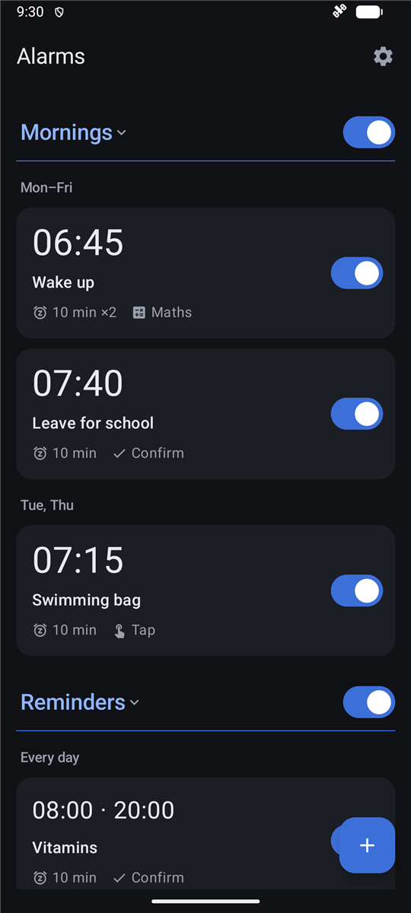
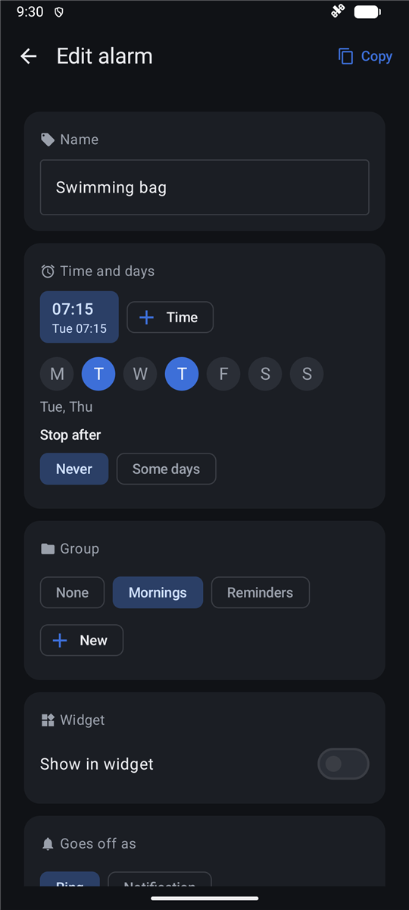
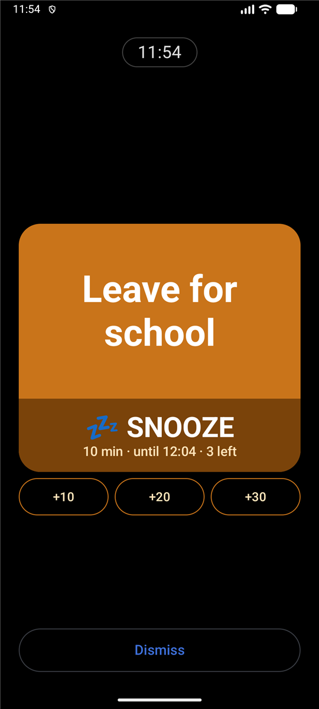

# Neckfors Alarm Clock

A simple Android alarm clock that always goes off, also for reminders such as medicine.

### [⬇ Download the Android app](https://github.com/neckfors/alarm-clock-releases/releases/latest)

For Android 8 or newer.

  
  
  

## Always goes off
- Rings even when the phone is silent or on vibrate, at full alarm volume, which can't be turned down
  while it rings. Your own volume comes back afterwards.
- Rings at the exact minute, over the lock screen and while you use the phone.
- Alarms are set again after a restart. One missed while the phone was off rings when it starts.
- On Android 14 and older it can also turn Do Not Disturb off while it rings.

## Alarms
- Set a clock time, or a number of minutes from now.
- One alarm can have several times a day, repeat on the days you pick, and stop after a number of days.
- **Goes off** as a full-screen alarm or as a notification with sound.
- **Snooze:** a big button, with your choice of length and number of snoozes, or none at all.
  With Tap or Confirm you can also make a snooze longer with +10, +20 or +30 minutes.
- **Dismiss:** with a tap, a question, maths, or numbered tiles tapped in order, for when you must wake up.
- **Groups:** switch several alarms off together, until you switch them on or until a date.
- Copy an alarm, set what new alarms start with, and back up your alarms to a file.

## Widgets
- **Quick alarm:** set an alarm a few minutes from now from the home screen, and add more time with
  each tap.
- **Alarms:** tick off the alarms you choose, such as medicine, and see which are done today and on
  earlier days.

## Install
1. Open the [newest release](https://github.com/neckfors/alarm-clock-releases/releases/latest) on your
   phone and download the `.apk` file.
2. Open it, and allow your browser or file manager to install apps when asked.
3. Open the app and allow what the **Setup** screen lists. This is what lets the alarms always ring.

**Updates:** the app tells you when there is a new version (or tap **Check for updates** in Settings).
Install it over the old one; your alarms stay.

## Support

If you like the app, you can support the author on [PayPal](https://paypal.me/neckfors). Thank you!
